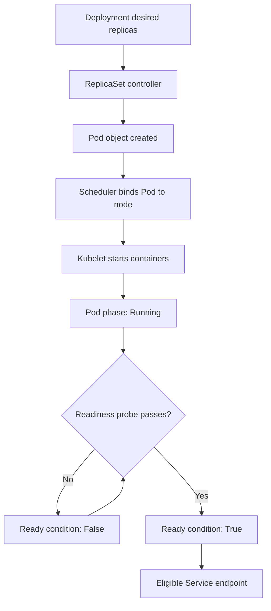

# Kubernetes Resilience & Production Troubleshooting Labs

A hands-on, evidence-driven learning repository for Kubernetes, DevOps, platform engineering, and Kafka operations.

> **Lab status:** Initial documentation and reproducible manifests are available. Observed results will be added only after running the exercises.

## Learning method

**Build → Break → Observe → Diagnose → Recover → Verify → Explain**

Every incident includes an expected failure, a minimal reproduction, commands to inspect the system, recovery steps, and interview discussion. Do not run fault-injection exercises in production.

## Labs

| Lab | Topic | Status |
| --- | --- | --- |
| [001](labs/001-running-not-ready/README.md) | Running Pod but Not Ready (readiness HTTP 404) | Ready to execute |
| 002 | CrashLoopBackOff and application startup | Planned |
| 003 | ImagePullBackOff and registry credentials | Planned |
| 004 | Rolling deployment, rollback vs roll-forward | Planned |
| 005 | Service, EndpointSlice, DNS and network policies | Planned |
| 006 | Resource limits, OOMKilled, eviction and PDB | Planned |
| 007 | Kafka broker failure, consumer lag and rebalancing | Planned |
| 008 | GitHub Actions delivery and EKS/MSK mapping | Planned |

## Environment

- Windows PowerShell and WSL2
- Local kind context: `kind-prod-sim`
- Existing Docker Kafka KRaft cluster (three brokers)
- Dedicated short-lived namespaces for experiments

Always verify your context before applying manifests. Labs should not modify existing Kafka or PostgreSQL workloads.

## Kubernetes mental model

**Running is a Pod phase. Ready is a Pod condition.** A running application may still be ineligible for Service traffic.

## Evidence policy

Use real commands and capture sanitized terminal output. Remove credentials, tokens, internal URLs and sensitive customer data. Simulated interview examples must be explicitly marked as simulated.

## Cleanup

Every lab must document the namespace it creates and the corresponding deletion command. Verify the namespace belongs to the lab before deletion.
