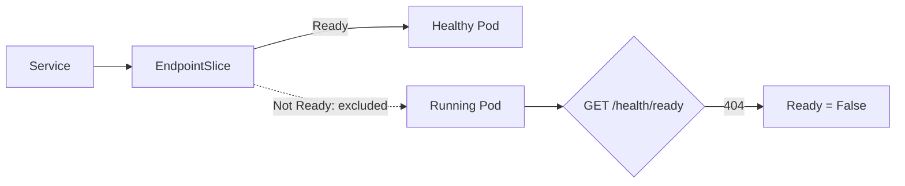

# Lab 001 — Pod Running but Not Ready

**Status: Readiness failure reproduced, diagnosed, and recovery verified on local kind. Cleanup pending.**

## Goal

Reproduce a Pod whose container is Running but whose `Ready` condition is false because its HTTP readiness probe checks a missing path.

### How traffic eligibility works



Readiness failure does not by itself restart the container. It removes the Pod from normal Service endpoint eligibility. Liveness and startup probes have different responsibilities.

## Prerequisites

- `kubectl` installed
- Existing kind cluster with context `kind-prod-sim`
- PowerShell terminal

## Build and break (PowerShell)

First check the context:

```powershell
kubectl config current-context
kubectl get nodes
```

**Only continue if the context is `kind-prod-sim`.**

```powershell
kubectl create namespace readiness-lab
@'
apiVersion: v1
kind: Pod
metadata:
  name: readiness-demo
  namespace: readiness-lab
  labels:
    app: readiness-demo
spec:
  containers:
    - name: web
      image: nginx:alpine
      ports:
        - containerPort: 80
      readinessProbe:
        httpGet:
          path: /health/ready
          port: 80
        initialDelaySeconds: 3
        periodSeconds: 5
'@ | kubectl apply -f -
```

NGINX serves `/` but normally returns 404 for `/health/ready`.

## Observe and diagnose

```powershell
kubectl get pod readiness-demo -n readiness-lab -w
kubectl describe pod readiness-demo -n readiness-lab
kubectl logs readiness-demo -n readiness-lab
```

**Expected, not yet observed:**

```text
NAME             READY   STATUS    RESTARTS
readiness-demo   0/1     Running   0
Warning Unhealthy Readiness probe failed: HTTP probe failed with statuscode: 404
```

Questions to answer:
1. Why does `STATUS` show Running when `READY` is 0/1?
2. Which Kubernetes component performs the HTTP probe?
3. Does a failed readiness probe restart the container?
4. How would this affect a Service's EndpointSlice?

## Recover safely

Patch only the isolated lab Pod's readiness path using JSON Patch:

```powershell
kubectl patch pod readiness-demo -n readiness-lab --type=json -p '[{"op":"replace","path":"/spec/containers/0/readinessProbe/httpGet/path","value":"/"}]'
```

**Note:** Pod probe configuration may be mutable on supported Kubernetes versions; if the API rejects the patch, delete and recreate only this lab Pod with the corrected path. Never patch unrelated workloads.

Verify:

```powershell
kubectl get pod readiness-demo -n readiness-lab
kubectl describe pod readiness-demo -n readiness-lab
```

Expected after successful correction: `1/1 Running`.

## Production discussion

- Correct the Deployment manifest or Helm values in Git, not just a live Pod.
- For a bad rollout, compare roll-forward versus rollback based on severity and the safety of the correction.
- An unready new Pod alone does not explain HTTP 503s while healthy old endpoints remain; investigate Service endpoints, ingress and capacity before attributing causality.
- EKS uses the same kubelet readiness mechanism; AWS load balancer health checks are a separate layer.

## Evidence checklist

- [ ] Capture `kubectl get pod` before fix
- [ ] Capture `kubectl describe pod` readiness events
- [ ] Record exact fix and command result
- [ ] Capture `kubectl get pod` after fix
- [ ] Write a three-sentence root cause / fix / verification explanation
- [ ] Remove sensitive details before publishing

## Cleanup

```powershell
kubectl delete namespace readiness-lab
```

Only delete the namespace created for this lab.

## Verified local evidence — 2026-11-14

The following observations were supplied from the local `kind-prod-sim` cluster; recovery has now been verified; namespace cleanup is pending.

```text
$ kubectl get pods -n readiness-lab
NAME             READY   STATUS    RESTARTS   AGE
readiness-demo   0/1     Running   0          22s

$ kubectl describe pod readiness-demo -n readiness-lab
Node: prod-sim-worker3
Status: Running
Container: web
  State: Running
  Ready: False
  Restart Count: 0
  Readiness: http-get http://:80/health/ready
Conditions:
  Ready: False
  ContainersReady: False
Events:
  Normal Scheduled Successfully assigned to prod-sim-worker3
  Normal Pulled Successfully pulled image nginx:alpine
  Normal Started Container started
  Warning Unhealthy (x15) Readiness probe failed: HTTP probe failed with statuscode: 404
```

**Evidence interpretation:** The container starts, but the readiness probe receives HTTP 404. The application endpoint and configured probe path need to be compared before a root cause is formally confirmed. Recovery verified; namespace cleanup pending.

### Endpoint verification (user-observed)

`kubectl exec -n readiness-lab readiness-demo -- wget -S -O /dev/null http://127.0.0.1:80/` returned **HTTP/1.1 200 OK**, server `nginx/1.31.8`. This supports the readiness-path mismatch diagnosis: the server responds at `/`, while the readiness probe against `/health/ready` returned 404. Fix and post-fix verification are recorded below; namespace cleanup remains pending.

### Recovery verified — 2026-11-14

The lab Pod was recreated with readiness path `/`. The user supplied this actual verification:

```text
$ kubectl get pod readiness-demo -n readiness-lab
NAME             READY   STATUS    RESTARTS   AGE
readiness-demo   1/1     Running   0          12s
```

**Outcome:** The replacement Pod is Running and Ready with no restarts. The original failing probe returned 404 at `/health/ready`, whereas NGINX responded 200 at `/`. No Service/EndpointSlice behavior was tested in this standalone-Pod exercise. Namespace cleanup still needs confirmation.
