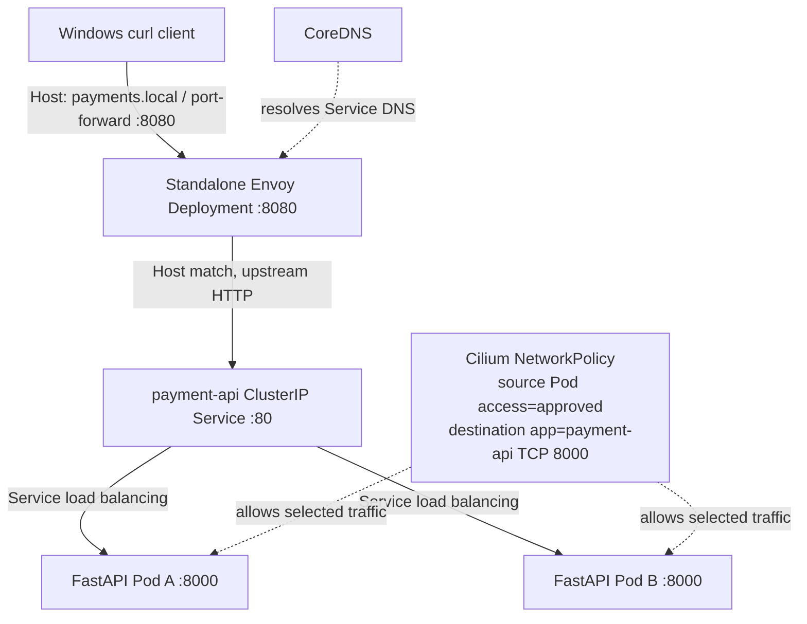

# Mission 006 — FastAPI, Kubernetes NetworkPolicy and Envoy HTTP routing

> Hands-on platform engineering lab · Windows PowerShell · kind `kind-prod-sim` · namespace `mission-006` · November 14, 2026

## Problem statement

A payment platform exposes a FastAPI backend through a Kubernetes ClusterIP Service. Clients need an HTTP entry point that selects backends using host/path rules, without exposing Pod IPs. The platform must preserve Kubernetes NetworkPolicy restrictions and support failure diagnosis.

This exercise implements **standalone Envoy HTTP routing**, not a Kubernetes Ingress controller. Cilium's Ingress controller was observed disabled; no cluster-wide Cilium changes were made.

## Architecture



**Layer boundaries:** CoreDNS resolves the Service name; kube-proxy (replacement disabled in this cluster) implements Service VIP forwarding via node dataplane rules; Cilium provides Pod networking and enforces NetworkPolicy; Envoy handles L7 host-based HTTP routing. Envoy's configured upstream is the **Service IP**, not individual Pod endpoints.

## Verified environment and checkpoints

| Component/check | Observed evidence |
|---|---|
| Helm Cilium | release `cilium`, chart/app version `1.20.2`, deployed |
| Ingress configuration | `ingressController.enabled: false`; `loadbalancerMode: dedicated` |
| IngressClass | none at inspection time |
| GatewayClass | resource type absent at inspection time |
| kube-proxy replacement | `false`; kube-proxy in use |
| StorageClass | `standard`, `rancher.io/local-path`, `WaitForFirstConsumer` (not CSI) |
| FastAPI | `payment-api` Deployment 2/2; two Running Pods, zero restarts |
| Service | `payment-api` ClusterIP `10.96.217.106:80` → Pod port `8000` |
| Envoy | `envoy-gateway` 1/1 Running, zero restarts |
| Policy | `payment-api-allow-approved` allows same-namespace Pods with `access=approved` to destination TCP 8000 |
| Success | `Host: payments.local` returned **HTTP 200**, `server: envoy`, `{"status":"ready"}` |
| Rejection | `Host: unknown.local` returned **HTTP 404**, `server: envoy` |

The user subsequently reported editing the Envoy Deployment to persist `access=approved` on its Pod template; a post-edit rollout check is **not yet captured**.

## Reproduce the Envoy lab

Prerequisites: the existing FastAPI Deployment and Service from this mission, and namespace `mission-006`. The manifest includes a ConfigMap and a Deployment, with the approved Pod label persisted.

```powershell
kubectl apply -f .\networkpolicy.yaml
kubectl apply -f .\envoy-deployment.yaml
kubectl rollout status deployment/envoy-gateway -n mission-006
kubectl get pods -n mission-006 -l app=envoy-gateway --show-labels
```

In another PowerShell terminal:

```powershell
kubectl port-forward -n mission-006 deployment/envoy-gateway 8080:8080
```

From the original terminal:

```powershell
curl.exe -i -H "Host: payments.local" http://localhost:8080/health/ready
curl.exe -i -H "Host: unknown.local" http://localhost:8080/health/ready
```

Expected: HTTP 200 with the FastAPI readiness JSON, then HTTP 404 from Envoy. Port-forward is a **local test transport**, not production exposure. No Kubernetes Ingress resource is created by this manifest.

## Incident exercise — HTTP 503 upstream connection timeout

### Symptom

```text
HTTP/1.1 503 Service Unavailable
server: envoy
upstream connect error or disconnect/reset before headers.
reset reason: connection timeout
```

### Investigation timeline

1. Verified FastAPI Deployment was healthy (2/2) and Envoy Pod Running (1/1).
2. Inspected Envoy Pod labels: initially only `app=envoy-gateway` and Pod template hash.
3. Inspected the destination NetworkPolicy: it allows traffic only from same-namespace Pods labeled `access=approved` to TCP 8000.
4. Labeled the **existing** Envoy Pod `access=approved` for diagnosis. An earlier immediate Envoy retry still returned HTTP 503.
5. Inspected policy YAML; confirmed selector and destination port.
6. Ran an ephemeral curl debug container in Envoy's Pod network namespace; recovered its logs after the interactive session ended:
   - Service DNS resolved to `10.96.217.106`
   - TCP connection to Service port 80 succeeded
   - `GET /health/ready` returned HTTP 200, `server: uvicorn`, `{"status":"ready"}`
7. Retried through Envoy: HTTP 200, `server: envoy`, `x-envoy-upstream-service-time: 2`.
8. Tested unknown host: HTTP 404, confirming virtual-host rejection.

### Diagnostic commands

```powershell
kubectl get pods -n mission-006 -l app=envoy-gateway --show-labels
kubectl get networkpolicy -n mission-006 -o yaml
kubectl debug -n mission-006 pod/<envoy-pod-name> -it --image=curlimages/curl:8.11.1 --target=envoy -- curl -v --connect-timeout 5 http://payment-api.mission-006.svc.cluster.local:80/health/ready
kubectl logs -n mission-006 <envoy-pod-name> -c <debugger-container-name>
```

**Root-cause confidence:** the initial missing source label and subsequent recovery strongly support NetworkPolicy denial as the cause. No Cilium drop event was captured, so this is a **supported hypothesis, not conclusively proven**. A healthy backend does not establish end-to-end reachability.

## Tradeoffs and production hardening

- **Why Envoy?** Host/path-based L7 routing, extensible TLS termination, observability, HTTP retry/timeout and rate-limit integration. None of these are automatically production-ready just because Envoy is running.
- **Why not just CoreDNS and kube-proxy?** They solve name resolution and L3/L4 Service forwarding, not HTTP host/path routing.
- **Security:** the `access=approved` label is a teaching shortcut; any actor permitted to create/label Pods could impersonate it. Production needs RBAC/admission controls and more restrictive workload identity boundaries. This policy has no Envoy egress restriction.
- **Availability:** one Envoy replica is a lab-only single point of failure. Production requires redundant replicas, proper exposure, rollout strategy and observability.
- **Routing:** Envoy `STRICT_DNS` resolves the ClusterIP Service and has one configured upstream endpoint; its round-robin policy is **not** selecting FastAPI Pods. Kubernetes Service networking handles Pod selection.
- **Ingress:** a standalone Envoy Deployment does not watch/reconcile Kubernetes Ingress resources. Cilium Ingress, Gateway API or another controller is a separate integration choice.
- **Persistence:** updating only a live Pod's labels does not survive replacement. Persist labels in the Deployment Pod template and verify the rollout.

## Interview-ready explanation

> We exposed a FastAPI payment service through standalone Envoy with hostname-based L7 routing. The first end-to-end request returned an Envoy 503 upstream timeout despite two healthy backend replicas. We traced the failure across the HTTP gateway, Service DNS, ClusterIP, Cilium NetworkPolicy and Pod connectivity. Envoy initially lacked the label required by the destination ingress policy. After applying the approved label, we verified direct HTTP 200 from the Envoy Pod network namespace, then HTTP 200 through Envoy and HTTP 404 for an unknown host. We documented the remaining hardening work and avoided a cluster-wide Cilium reconfiguration.

## Evidence and next work

- [Envoy route configuration](envoy.yaml)
- [ConfigMap + Envoy Deployment](envoy-deployment.yaml)
- [NetworkPolicy](networkpolicy.yaml)
- Existing FastAPI [application](app/main.py), [Dockerfile](Dockerfile), [Deployment](deployment.yaml) and [Service](service.yaml)
- **Pending verification:** post-edit Envoy rollout, repeat positive/negative tests after replacement, and cleanup
- **Not yet implemented/verified:** Redis, durable job queue, worker retries/idempotency, GitHub Actions CI/CD, AWS EKS/ALB

### Cleanup (when finished)

```powershell
kubectl delete namespace mission-006
```

Only run cleanup after preserving any desired terminal evidence and completing the remaining Mission 006 exercises.
