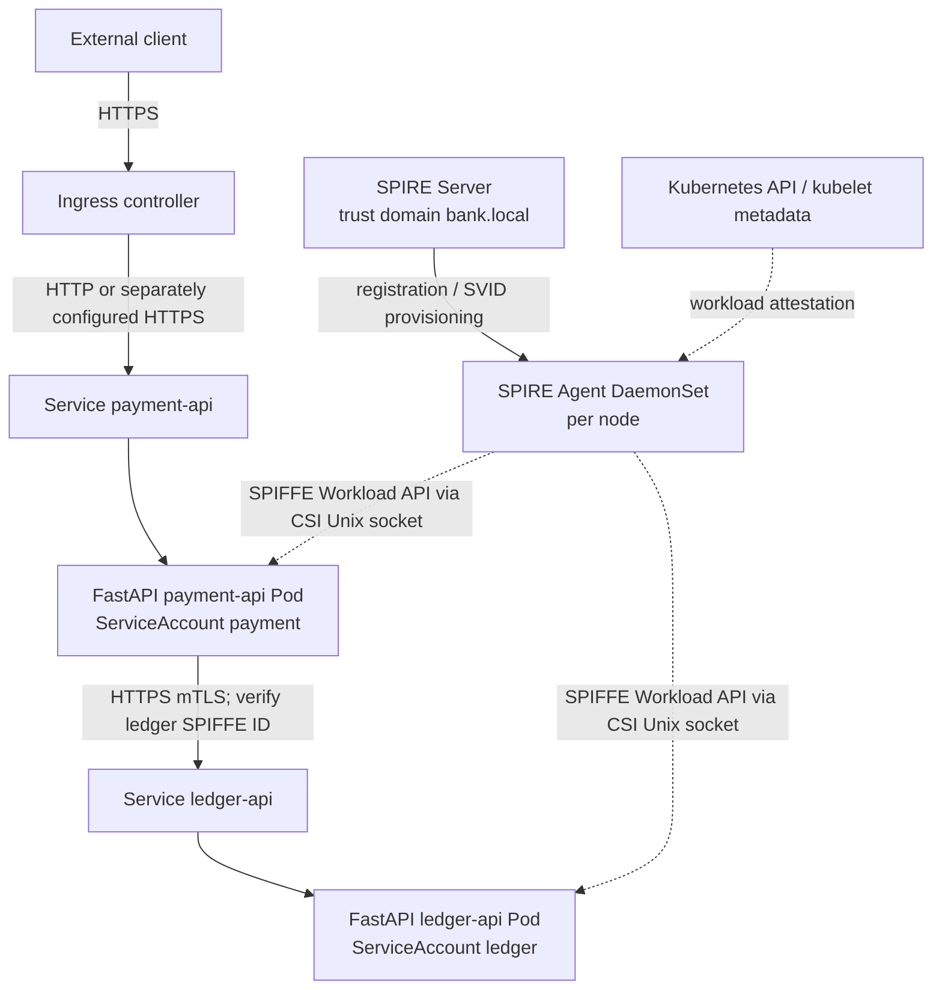
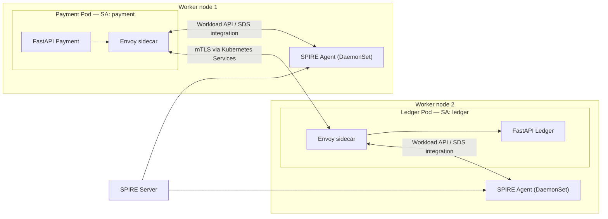
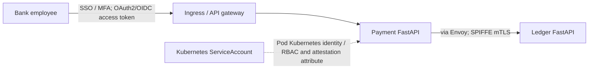

# Mission 007 — Kubernetes SPIFFE/SPIRE workload identity and pod-to-pod mTLS

> Status: **Partially completed lab** (2026-11-15). Manual certificate-based mTLS passed. SPIRE node attestation, registration, and CSI socket mount passed; workload X.509-SVID retrieval failed with `PermissionDenied: no identity issued`. SPIRE-backed end-to-end mTLS and SPIFFE-ID authorization were **not** demonstrated.

## 1. Production architecture: two FastAPI services



The Service and Ingress handle routing, not workload identity. **Ingress TLS is separate from internal pod-to-pod mTLS**; a TLS connection to Ingress does not imply encrypted or mutually authenticated traffic from Ingress to the backend. The SPIRE Agent authenticates local workloads; the SPIRE Server maintains registrations and signs SVIDs. In a multi-node deployment, each Pod talks to its **local** SPIRE Agent.

### Identity examples

- Payment: `spiffe://bank.local/ns/banking/sa/payment`
- Ledger: `spiffe://bank.local/ns/banking/sa/ledger`
- Authorization rule at Ledger: **allow only** the Payment SPIFFE ID (plus any explicitly approved callers); reject unknown identities even if their certificates chain to a trusted SPIRE CA.
- Payment also validates the Ledger SPIFFE ID to prevent connecting to an impostor service.

## 2. Where Kubernetes ServiceAccounts fit

Assign a **distinct ServiceAccount to each workload** (not a shared `default` account). Kubernetes uses ServiceAccounts for API authentication; SPIRE's Kubernetes workload attestor can use verified Pod attributes such as namespace, ServiceAccount and Pod UID to match registration selectors. A ServiceAccount token is **not itself** an X.509-SVID. SPIRE issues an SVID only after successful workload attestation and registration matching.

```yaml
apiVersion: v1
kind: ServiceAccount
metadata:
  name: payment
  namespace: banking
---
apiVersion: v1
kind: ServiceAccount
metadata:
  name: ledger
  namespace: banking
```

In the payment Deployment, set `spec.template.spec.serviceAccountName: payment`; in the ledger Deployment use `ledger`. If the application doesn't call the Kubernetes API, consider `automountServiceAccountToken: false` **only after validating compatibility with your attestation method and CSI setup**. For this lab we retained the token.

A typical SPIRE CSI socket mount in **each** workload Pod:

```yaml
spec:
  template:
    spec:
      serviceAccountName: payment
      containers:
      - name: payment-api
        image: example.invalid/payment-api:replace-me
        volumeMounts:
        - name: spiffe-workload-api
          mountPath: /run/spire/sockets
          readOnly: true
        env:
        - name: SPIFFE_ENDPOINT_SOCKET
          value: unix:///run/spire/sockets/spire-agent.sock
      volumes:
      - name: spiffe-workload-api
        csi:
          driver: csi.spiffe.io
          readOnly: true
```

This is a **fragment**, not a ready-to-apply Deployment. The application or proxy must implement the SPIFFE Workload API client and mTLS handshake; mounting the socket alone does not enable mTLS.

## 3. Request path and trust decisions

1. Client connects to Ingress using public HTTPS; Ingress selects `payment-api` Service.
2. Kubernetes Service routes to a ready Payment Pod. Internal Ingress-to-Payment transport must be secured separately if required.
3. Payment resolves `ledger-api.banking.svc.cluster.local` and opens an mTLS connection.
4. Payment and Ledger each obtain short-lived X.509-SVIDs and trust bundles from their local SPIRE Agent Workload API. The application/proxy handles refresh/rotation.
5. During mTLS, both parties verify the peer certificate chain and expected SPIFFE URI SAN. Ledger **authorizes** `spiffe://bank.local/ns/banking/sa/payment` specifically.
6. Ledger returns the response through the authenticated connection. Kubernetes NetworkPolicies can provide complementary network-layer restrictions, but do not replace identity-based authorization.

**Deployment options:** (A) SPIFFE-aware application SDK (e.g. Go SDK; Python requires a compatible integration), or (B) Envoy/service-mesh sidecars configured to retrieve SPIRE-issued identities and enforce peer identity policy. Neither is automatically enabled by SPIRE installation.

## 4. Our actual kind lab and evidence

Environment: Windows PowerShell, kind cluster `kind-prod-sim`, namespace `mtls-lab`, SPIRE in `spire-lab`, trust domain `bank.local`.

| Check | Observed |
|---|---|
| Manual Bank-Lab-CA mTLS | Payment client certificate accepted by Ledger HTTPS server; no certificate rejected |
| SPIRE Server | `spire-server-0` running |
| SPIRE Agents | DaemonSet running on three worker nodes |
| Node attestation | `Node attestation was successful` for `spiffe://bank.local/spire/agent/k8s_psat/prod-sim/...` |
| SPIFFE CSI | Payment Pod mounted `/run/spire/sockets/spire-agent.sock` |
| ClusterSPIFFEID | `payment-identity` status: `podsSelected: 3`, `entriesToSet: 3`, `entryFailures: 0` |
| Workload registration | Payment SPIFFE ID with namespace, ServiceAccount, Pod UID selectors and correct Agent parent |
| X.509-SVID fetch | **Failed:** `rpc error: code = PermissionDenied desc = no identity issued` |
| SPIRE-backed Payment → Ledger mTLS | **Not tested / not proven** |
| SPIFFE-ID allow/deny | **Not tested / not proven** |

### Troubleshooting findings

- Agent reported `registered=false` on `FetchX509SVID` even though Server registrations existed. This suggests no eligible identity matched the requesting process; precise root cause is **unconfirmed**.
- The Kubernetes WorkloadAttestor plugin was loaded with `use_new_container_locator: true` and `skip_kubelet_verification: true`. Agent `hostPID: true`.
- The diagnostic Pod was one-shot and failed on multiple attempts; restarting the Agents did not resolve it. Agent-side `Creating X509-SVID` log messages **do not prove successful delivery** to the workload.
- Verbose locator logs were temporarily enabled in the Helm-managed `spire-agent` ConfigMap. Revert via chart-managed values/Helm reconciliation or uninstall when cleaning up.
- Avoid committing private keys, SVID material, Kubernetes tokens, or secret-bearing logs.

### Follow-up investigation (deferred)

1. Keep a diagnostic workload running so registration propagation and process attestation can be observed independently.
2. Correlate calling PID, Pod UID, container ID, cgroup/container locator diagnostics, Agent node and registration parent.
3. Compare actual workload selectors with registered selectors; check SPIRE Agent logs at the time of the request.
4. Only after successful SVID retrieval, test payment→ledger SPIRE-backed mTLS and unauthorized SPIFFE-ID rejection.

## 5. Interview-ready answer

> We separate north-south TLS at Ingress from east-west service-to-service mTLS. Each FastAPI workload runs under a dedicated Kubernetes ServiceAccount. SPIRE uses Kubernetes workload attestation to map the running Pod to a registered SPIFFE ID and delivers short-lived X.509-SVIDs over a node-local Workload API socket, mounted via the SPIFFE CSI driver. An SPIFFE-aware application or Envoy sidecar then establishes mutual TLS, validates the peer's SPIFFE ID, and applies explicit authorization policy. Services provide discovery and load balancing; they do not themselves implement mTLS. In our lab we validated manual mTLS and SPIRE node registration/attestation, but the workload SVID fetch remained blocked, so we did not claim full SPIRE-backed mTLS.

## 6. Cleanup (after preserving evidence)

```powershell
# Inspect resources before deletion:
kubectl -n mtls-lab get pods,svc,deploy
kubectl -n spire-lab get pods
kubectl get clusterspiffeid payment-identity

# Only when this lab is no longer needed:
kubectl delete clusterspiffeid payment-identity --ignore-not-found
kubectl delete namespace mtls-lab --ignore-not-found
# SPIRE may be shared; do NOT uninstall it without confirming no other labs depend on it.
```

**Do not claim SPIRE-backed mTLS succeeded until both positive and negative peer-identity tests pass.**


## 7. Step-by-step mental model: initial attestation, mTLS and renewal

### 7.1 Where each component lives



- **ServiceAccount:** declared in each Deployment's Pod template (`serviceAccountName`). Kubernetes normally assigns the namespace's `default` ServiceAccount when unspecified; dedicated per-workload ServiceAccounts are recommended.
- **SPIRE Agent:** installed by platform engineering as a **node-level DaemonSet**, not an application sidecar. Each Envoy talks to its local Agent through a securely mounted Unix socket and a compatible SPIFFE/SDS integration.
- **Envoy:** a sidecar in each Pod, configured to use SPIRE-provided X.509-SVIDs for mTLS and validate/authorize the peer's SPIFFE URI SAN. Transparent traffic capture or explicit proxy routing must be configured; merely running Envoy does not intercept traffic.
- **SPIRE Server:** holds registration information, trust material and issuance services. It is **not** in the HTTP request path.
- **Same or different namespaces:** both work. Identity can include namespace and ServiceAccount; cross-namespace access is controlled by explicit policy, not automatically denied by SPIFFE.

### 7.2 Timeline: NOT one attestation per HTTP request

```mermaid
sequenceDiagram
    participant P as Payment FastAPI
    participant E as Payment Envoy
    participant A as Local SPIRE Agent
    participant S as SPIRE Server
    participant L as Ledger Envoy
    Note over E,A: Startup: identity acquisition
    E->>A: Establish Workload API / SDS identity subscription
    A->>A: Attest requesting process using Kubernetes selectors
    A-->>E: Current X.509-SVID + trust bundle
    Note over A,S: Agent obtains and renews issued SVIDs with SPIRE infrastructure
    Note over P,L: 10 minutes later: application request
    P->>E: POST /ledger
    E->>L: New mTLS connection using cached valid SVID
    L-->>E: Authenticate peer; authorize Payment SPIFFE ID
    E-->>P: Response
    Note over E,A: Before certificate expiry: renewal
    A-->>E: Updated X.509-SVID via ongoing subscription
    Note over P,L: 35 minutes later: another request
    P->>E: POST /ledger
    E->>L: Use current identity; handshake only if new TLS connection
    L-->>E: Response
```

**The certificate TTL is not an attestation timer.** Workload attestation happens when the Agent identifies a client connecting to its Workload API; reconnecting may trigger it again. Identity renewal can occur over an existing subscription without a new workload attestation each time. A 30-minute SVID lifetime does **not** mean Envoy must re-attest every 30 minutes. A new TLS connection does perform a TLS handshake; existing HTTP keep-alive connections may be reused. Actual certificate refresh timing is implementation/configuration-dependent.

### 7.3 Two independent authentication domains



A human opening Swagger UI is authenticated and authorized with corporate identity and API permissions, **not** the Pod's Kubernetes ServiceAccount. SPIFFE mTLS authenticates **workloads**, not automatically the end-user's business authorization. In banking, restrict Swagger access and separately enforce API authorization.

### 7.4 Production ownership, rotation and alerting

| Owner | Responsibility |
|---|---|
| Platform/SRE | Operate SPIRE Server, Agent DaemonSet, CSI/SDS integrations, trust domain, identity registrations and availability |
| Application team | Dedicated ServiceAccount, approved identity mapping, Envoy integration via platform templates, allowed callers, downstream error monitoring |
| Security | Review trust and peer-authorization policies, audit identity anomalies |

**Rotation:** SPIRE and the configured client/proxy integration distribute renewed short-lived SVIDs before expiry. The app team should not manually distribute private keys or implement a custom cron job for certificate replacement.

**Alert on outcomes, not only healthy Pods:**
1. SPIRE Server/Agent health and registration/attestation errors.
2. Failed or stale X.509-SVID renewal and **remaining lifetime of the active certificate** (may need a custom exporter).
3. Envoy SDS delivery/rejection errors, TLS handshake failures, unauthorized peer IDs and downstream connection failures.
4. Distinguish normal renewal from an outage: a temporary Server failure does not immediately invalidate unexpired cached SVIDs, but expiry can break **new** handshakes.

### 7.5 Interview answer (short)

> Each FastAPI Deployment uses a dedicated Kubernetes ServiceAccount. Platform engineering runs SPIRE Server and node-local SPIRE Agents. Our Envoy sidecars subscribe to the SPIFFE workload identity material through the Agent integration. The Agent attests the calling workload and matches registered selectors; SPIRE issues short-lived X.509-SVIDs. Envoy uses the current SVID to mutually authenticate with the downstream Envoy and checks its authorized SPIFFE ID. The Agent and integration refresh identity material before expiry; neither a new HTTP request nor the certificate's TTL automatically triggers a fresh workload attestation. We monitor identity delivery, renewal and handshake failures in addition to SPIRE availability.

**Evidence boundary:** Section 7 describes the **target production design**, not a completed SPIRE-backed mTLS verification in our Mission 007 lab; see Section 4 for actual results.
